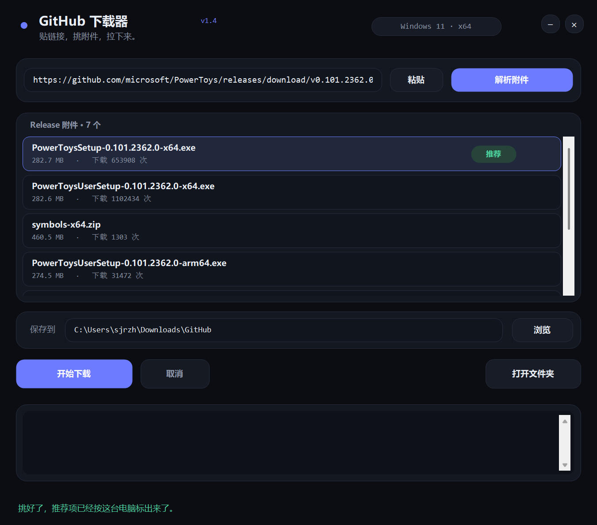

# GitHub 下载器

Windows 桌面版 GitHub 下载工具：粘贴链接 → 自动解析 Release 附件 → 按这台电脑的环境标出该下哪个 → 用多连接脚本拉下来。



## 特性

- **无边框暗色界面**：圆角卡片、胶囊按钮，Per-Monitor V2 DPI 感知，150% 缩放下字体依然锐利
- **智能解析**：粘贴 `owner/repo`、Release 页面或资产直链都能识别；自动拉取附件列表（名称、大小、下载次数）
- **按环境推荐**：按 Windows + 架构打分，`x64` / `.exe` / `.msi` 加分，`arm64` / `linux` / `macos` / 源码包扣分，最高分那一条挂「推荐」并自动选中
- **多连接下载**：调用 `scripts/` 里的 PowerShell 引擎（分段并发、断点续传、镜像回退）
- **实时日志**：下载过程逐行滚动，可取消（结束整棵进程树），完成后一键打开目录
- **单实例 + 纯 popup 窗口**：不会重复开窗，也不会冒出系统标题栏

## 下载

到 [Releases](../../releases) 页下载：

- `GitHubDownloader.exe` —— 单文件免安装（首次运行会自动在同目录找 `scripts\gh.ps1`，找不到再回退到 `%LOCALAPPDATA%\GitHub下载器\gh.ps1`）
- `GitHubDownloader-v1.4.0-win-x64.zip` —— 完整包（exe + scripts + README）

## 使用

1. 双击 `GitHubDownloader.exe`
2. 粘贴链接（或直接把链接拖进窗口）
3. 点「解析附件」，列表里默认已经选中推荐项
4. 点「开始下载」，日志区实时滚动；完成后点「打开文件夹」

支持三种输入：

| 输入 | 行为 |
|---|---|
| `https://github.com/owner/repo/releases/download/...` | 直接下这个文件 |
| `https://github.com/owner/repo`（或 `owner/repo`） | 解析 latest Release，列出附件 |
| `https://github.com/owner/repo/releases/tag/v1.2.3` | 解析指定 tag 的附件 |

## 目录结构

```
.
├─ src/
│  ├─ Program.cs          # 全部界面与逻辑（WinForms，单文件）
│  └─ app.manifest        # DPI 感知 + 主题
├─ scripts/               # 下载引擎（PowerShell）
│  ├─ gh.ps1              # 入口：判断下文件还是拉仓库
│  ├─ gh-dl.ps1           # 多连接分段下载
│  ├─ gh-clone.ps1        # 仓库打包下载
│  └─ Get-GhClip.ps1      # 从剪贴板取链接
├─ assets/
│  ├─ icon.png            # 图标原图（AI 生成）
│  ├─ icon.ico            # 多尺寸图标（16–256）
│  └─ icon-src.webp       # 生成原稿
├─ docs/screenshot.png
├─ build.ps1              # 编译脚本
└─ make-icon.py           # WebP → PNG/ICO
```

## 构建

需要 Windows 自带的 .NET Framework 4.8（`csc.exe`）：

```powershell
powershell -ExecutionPolicy Bypass -File build.ps1
# 产物：dist\GitHubDownloader.exe（并复制 scripts\ 到 dist\scripts\）
```

加 `-Install` 会把 exe 复制到桌面。

## 图标

图标由 **FLUX.1-schnell**（Hugging Face 免费 Space）生成，再用 `make-icon.py`（Pillow）转成多尺寸 ICO 嵌进 exe。

## 说明

- 仅支持 Windows（用到了 DWM、WinForms 与 PowerShell）
- 下载引擎依赖机器上可用的 `curl.exe` / PowerShell 5.1（Windows 10 1803+ 自带）
- 未登录的 GitHub API 每小时 60 次，解析过于频繁会限流，界面会提示

## English

A small Windows GUI for GitHub releases and repositories: paste a link, resolve the release assets, get a recommendation that matches your OS and architecture, and download with a multi-connection PowerShell engine. Single-file exe, no installer. MIT licensed.

## License

[MIT](LICENSE)
