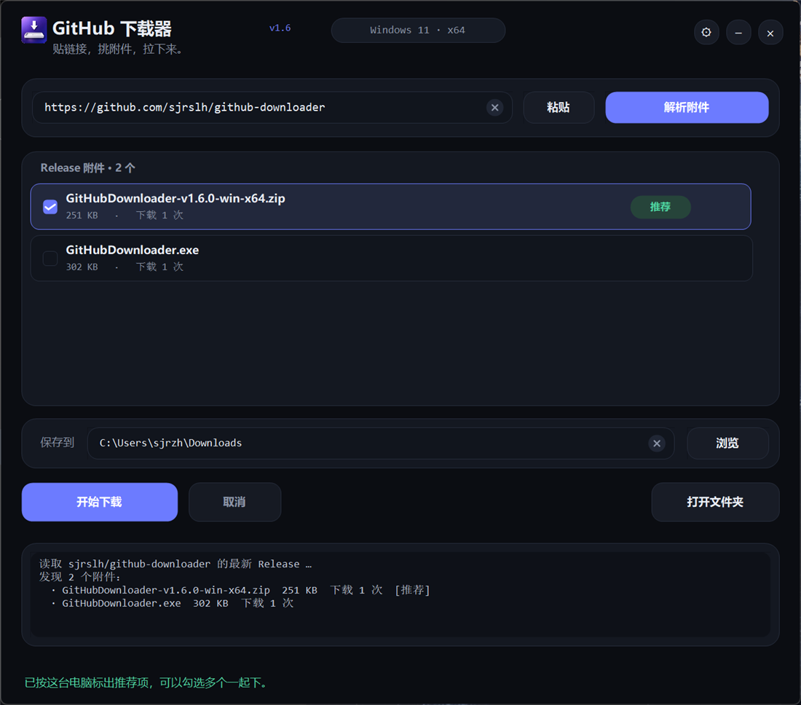
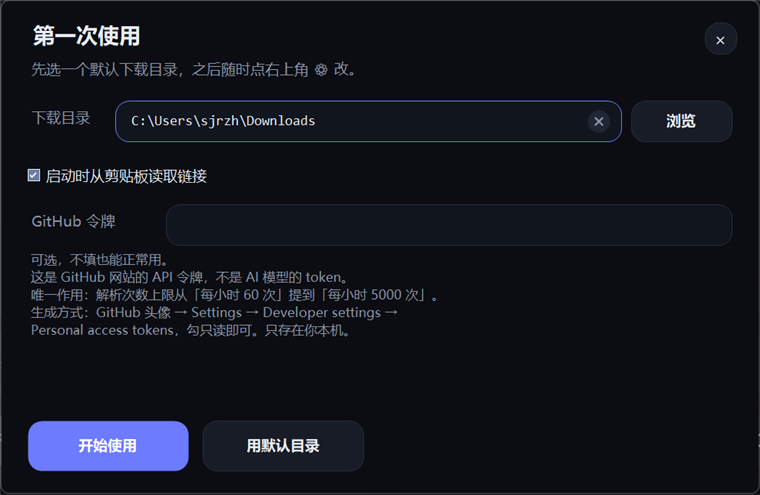
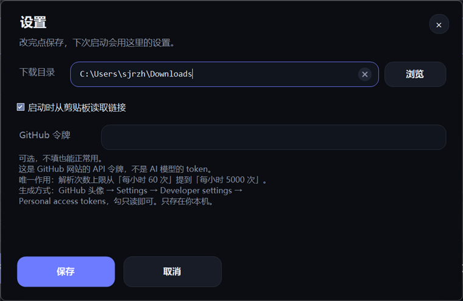

# GitHub 下载器

Windows 桌面版 GitHub 下载工具：粘贴链接 → 自动解析 Release 附件 → 按这台电脑的环境标出该下哪个 → 用多连接脚本拉下来。



## 特性

- **无边框暗色界面**：圆角卡片、胶囊按钮，Per-Monitor V2 DPI 感知
- **智能解析**：粘贴 `owner/repo`、Release 页面或资产直链都能识别；自动拉取附件列表（名称、大小、下载次数）
- **按环境推荐**：按 Windows + 架构打分，`x64` / `.exe` / `.msi` 加分，`arm64` / `linux` / `macos` / 源码包扣分，最高分那一条挂「推荐」并自动勾选
- **多选批量下载**：附件列表每行都有勾选框，勾几个下一次全部拉完，进度里带 `[2/3]` 这样的队列序号
- **真实进度**：进度条按百分比走，状态栏显示「已下 / 总量 · 百分比 · 速度 · 剩余时间」，不再是一条不知道走到哪的跑马灯
- **断点续传**：分段状态写在 `.<文件名>.ghdl-state` 里，中断后重跑只补没下完的分块
- **默认存到系统「下载」**：和浏览器下载的位置一致（走 `SHGetKnownFolderPath`，下载夹被重定向到 D 盘/OneDrive 也能认对）；想换目录点右上角 ⚙ 或「浏览」，设置写在 `%LOCALAPPDATA%\GitHub下载器\settings.ini`
- **可选 Token**：在 ⚙ 里填一个 GitHub Personal Access Token，API 限额从 60 次/小时提到 5000 次/小时（只存在本地）
- **单实例 + 纯 popup 窗口**：不会重复开窗，也不会冒出系统标题栏
- **命令行参数**：`--url` / `--out` / `--auto` / `--exit`，方便脚本化调用

## 下载

到 [Releases 页](https://github.com/sjrslh/github-downloader/releases) 下载：

- `GitHubDownloader.exe` —— 单文件免安装（首次运行会在同目录找 `scripts\gh.ps1`，找不到再回退到 `%LOCALAPPDATA%\GitHub下载器\gh.ps1`）
- `GitHubDownloader-vX.Y.Z-win-x64.zip` —— 完整包（exe + scripts + README + LICENSE）

## 使用

1. 双击 `GitHubDownloader.exe`
2. 默认保存位置就是系统的「下载」文件夹，和浏览器一样；想改就点右上角 ⚙
3. 粘贴链接（或直接把链接拖进窗口），点「解析附件」
4. 列表里推荐项已经自动勾好；需要多下几个就继续点其他行勾选
5. 点「开始下载」，进度条和状态栏实时更新；完成后点「打开文件夹」





支持三种输入：

| 输入 | 行为 |
|---|---|
| `https://github.com/owner/repo/releases/download/...` | 直接下这个文件 |
| `https://github.com/owner/repo`（或 `owner/repo`） | 解析 latest Release，列出附件 |
| `https://github.com/owner/repo/releases/tag/v1.2.3` | 解析指定 tag 的附件 |

### 命令行

```powershell
# 解析仓库的 latest Release，按推荐项直接下载，下完自动退出
GitHubDownloader.exe --url owner/repo --out "D:\Downloads" --auto --exit

# 直接下载一个资产到指定目录
GitHubDownloader.exe --url "https://github.com/owner/repo/releases/download/v1.0/app.zip" --out "D:\Downloads" --auto --exit
```

| 参数 | 说明 |
|---|---|
| `--url <链接或 owner/repo>` | 启动时填入目标 |
| `--out <目录>` | 临时指定下载目录（不写入设置） |
| `--auto` | 解析完成后立刻按推荐项开始下载；直链则直接下 |
| `--exit` | 下载结束后自动退出 |

## 下载引擎

`scripts/gh-dl.ps1` 是独立的 PowerShell 下载器，也可以脱离界面单独用：

```powershell
.\scripts\gh-dl.ps1 https://github.com/owner/repo/releases/download/v1/x.zip -OutDir D:\tmp
.\scripts\gh-dl.ps1 owner/repo -OutDir D:\tmp -Connections 8
```

它的做法（都是实测出来的结论）：

1. **速度靠「直连 + 多连接」** —— 单连接 ~0.15~0.3 MB/s 且抖动大；16 并发直连实测能跑到 10~20 MB/s
2. **连通性靠「代理只取地址」** —— 加速器开着时 `github.com` 主站常连不上，但 `codeload` / `release-assets` 可直连。所以先用本地代理发一个 HEAD 拿 302 拿到真实地址，之后全程直连多连接，代理不承担正文字节
3. **引擎选择** —— 有 `aria2c` 就优先用它；没有就用内置的 .NET 分段并发器（**不依赖任何 PowerShell 模块**，Windows 自带的 5.1 直接能跑）；连内联编译都被限制的机器上退回单连接流式下载

脚本向 stdout 输出机器可读行，界面靠它画进度：

```
##PROGRESS <已下载字节> <总字节> <字节每秒>
##DONE     <文件路径> <总字节> <耗时秒>
##FAIL     <来源标签> <原因>
```

## 目录结构

```
.
├─ src/
│  ├─ Program.cs          # 全部界面与逻辑（WinForms，单文件）
│  └─ app.manifest        # PerMonitorV2 DPI + 主题
├─ scripts/               # 下载引擎（PowerShell）
│  ├─ gh.ps1              # 入口：判断下文件还是拉仓库
│  ├─ gh-dl.ps1           # 多连接分段下载（内置 .NET 引擎）
│  ├─ gh-clone.ps1        # 仓库打包下载
│  └─ Get-GhClip.ps1      # 从剪贴板取链接
├─ assets/
│  ├─ icon.png            # 图标原图（AI 生成，四角已抠透明）
│  ├─ icon.ico            # 多尺寸图标（16–128 BMP 条目 + 256 PNG）
│  └─ icon-src.webp       # 生成原稿
├─ tests/
│  └─ mock-release-server.py   # 本地 mock Release API，用来回归解析/下载/进度
├─ docs/
├─ build.ps1              # 编译脚本
├─ make-icon.py           # WebP → 去白角 → PNG
└─ make-ico.py            # PNG → 多尺寸 ICO
```

## 构建

需要 Windows 自带的 .NET Framework 4.8（`csc.exe`）：

```powershell
powershell -ExecutionPolicy Bypass -File build.ps1
# 产物：dist\GitHubDownloader.exe（并复制 scripts\ 到 dist\scripts\）
```

加 `-Install` 会把 exe 复制到桌面。

推一个 `v*` tag 时，GitHub Actions 会自动编译并发布 Release（见 `.github/workflows/build.yml`）。

## 安装位置（重要）

`build.ps1` 除了产出 `dist\GitHubDownloader.exe`，还会自动同步一份到：

```
%LOCALAPPDATA%\Programs\GitHubDownloader\
```

**建议从那里运行**（桌面快捷方式也指向那里）。原因：某些环境（受限沙箱、企业安全策略）会按**可执行文件所在目录**限制写权限——从这类目录启动的 exe 能读能联网，但写下载目录会报「访问被拒绝」。装到用户程序目录即可绕开，这是实测出来的。

已经部署过之后再跑 `build.ps1`，会自动跟着更新，不用每次加 `-Deploy`。

## 图标

图标由 **FLUX.1-schnell**（Hugging Face 免费 Space）生成：`make-icon.py` 先把 WebP 转成 PNG，并用圆角蒙版把四角的白底抠成透明；`make-ico.py` 再拼出多尺寸 ICO（16–128 用 BMP 条目、256 用 PNG——Explorer 只认 BMP 条目的小图标，纯 PNG 的 ICO 在桌面上会退回旧图标或通用图标）。

## 说明与限制

- 仅支持 Windows（用到了 DWM、WinForms 与 PowerShell）
- 依赖机器上的 `curl.exe` / PowerShell 5.1（Windows 10 1803+ 自带）
- **解析走三级回退：直连 → 系统代理 → curl 兜底**。兜底会自动探测本地常见代理端口（10808/10809/10810/7890/7891 等）并支持 `socks5h`——.NET 的 `HttpWebRequest` 原生不支持 socks，而国内加速器（sing-box / v2rayN 等）很多只开 socks 端口，靠这条路才能解析
- 下载主通道是直连多连接（`release-assets.githubusercontent.com` 通常可直连）；直连不通时自动回退公共镜像，再不行才整体走代理
- 未登录的 GitHub API 每小时 60 次；解析过于频繁会被限流，界面会提示，填 Token 可提到 5000 次
- 设置文件：`%LOCALAPPDATA%\GitHub下载器\settings.ini`；日志：同目录 `app.log`（超过 256 KB 自动轮转）
- exe 没有代码签名，首次运行可能被 SmartScreen 拦一次，点「更多信息 → 仍要运行」

## English

A small Windows GUI for GitHub releases and repositories: paste a link, resolve the release assets, get a recommendation that matches your OS and architecture, tick several of them and download in one batch with a multi-connection PowerShell engine (real percentage/ETA, resumable, no extra modules required). Optional Personal Access Token raises the API limit to 5000/h. Tiny CLI (`--url/--out/--auto/--exit`), single-file exe, no installer. MIT licensed.

## License

[MIT](LICENSE)
